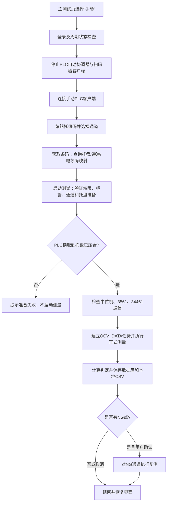

# 主测试页“手动”模式逻辑分析报告

**分析日期：** 2026-10-10  
**分析范围：** 主测试页 `frmTest` 中“测试控制”区域的“手动”切换按钮（控件名 `chkManualTest`）。  
**分析方式：** 静态阅读当前工作区源码；未连接设备，也未运行测试。

## 1. 先明确：这里说的是哪个“手动”

本报告分析的是：打开主测试页“测试”（MDI 子窗体 `frmTest`）后，在左侧“测试控制”区域，与“自动”并排的“手动”按钮。它在代码中的控件名是 `chkManualTest`，和 `chkAutoTest` 共同决定主测试页当前由谁发起测试。

| 界面入口 | 本报告是否分析 | 实际含义 |
|---|---:|---|
| 主测试页“测试控制 → 手动”（`frmTest.chkManualTest`） | **是** | 停止 PLC 自动测试协调器，转为由操作员填写/核对托盘码、选择通道并点击“启动测试”。 |
| 主菜单“测试 → 手动测试”（`MDIForm.ManualTestToolStripMenuItem`） | 否 | 打开独立的 `FrmManualTest` 对话框。该窗体有自己的通道选择、单次/多次测量、结果表格、CSV 和夹具控制逻辑。 |
| 主测试页“调试模式”（`chk_Test`） | 否，但会影响手动测试 | 这是另一项独立开关：开启后，托盘准备会生成临时电芯码并跳过正常托盘电芯数据查询。它不等同于“手动”模式。 |

主菜单项的事件直接创建并显示 `FrmManualTest`（`MDIForm.vb:145-150`）；主测试页的“手动”则由 `frmTest.vb:3210-3259` 处理。两条入口不能混为一谈。独立窗体目前复用 `FormalTestRunner`，但其流程和主测试页的正式测试不同（例如它没有主页面这套托盘码/`OCV_DATA` 任务流程；见 `FrmManualTest.vb:414-446`）。

## 2. 结论摘要

主测试页选“手动”后，系统**不会自动开始测量**。它关闭 PLC 自动测试协调器，建立手动模式所需的 PLC 连接，然后允许操作员在主测试页编辑托盘码、选择待测通道、点击“获取条码”准备托盘数据，最后点击“启动测试”。启动时仍必须通过 PLC 托盘压合状态和仪器/中位机通信检查。

所以这里的“手动”准确说是**操作员手动发起测试**，不是“绕过 PLC、夹具和设备的离线测量模式”。物理测量本身仍由中位机和仪器执行。

## 3. 切换到主测试页“手动”时发生什么

### 3.1 登录与切换限制

主页面加载后，切换模式要求已登录；如果登录取消或无法完成，代码会恢复原来的模式。若正在运行正式测试、自动测试轮次，或 PLC 协调器处于 `Idle` / `Fault` 以外的周期状态，切换会被拒绝，模式复原，并提示“测试周期进行中，不能切换模式”（`frmTest.vb:3214-3230`）。

两枚控件虽然是外观为按钮的 `CheckBox`，事件逻辑会让它们互斥；如果用户把当前选项取消、导致两项都未选中，代码会自动回到“自动”（`frmTest.vb:3233-3243`）。设计器默认选中“自动”（`frmTest.Designer.vb:1337-1353`）。

### 3.2 停止自动协调器并连接手动 PLC 客户端

模式状态更新后，切换到手动会调用 `StopPlcAutomaticTest()`，停止并释放 PLC 自动测试协调器及扫码器客户端，然后调用 `StartManualPlcConnection()`（`frmTest.vb:3244-3257`、`2228-2242`）。连接方式按 PLC 配置分支：

- `PLCMode = 0`：打开 `PlcAutomationClient` 使用的 PLC 串口；手动主页面后续用它读取 R151 托盘状态。
- `PLCMode <> 0`：调用 `CheckPlc()`，由 `PlcControllerFactory` 按配置创建 Modbus 控制器；`PLCMode = 1` 对应 Modbus TCP（`frmTest.vb:2354-2367`、`Module1.vb:782-801`、`PlcController.vb:18-23`）。

如果串口打开异常，界面显示“手动 PLC 连接失败…”，但异常处理没有把模式按钮切回自动。因此**模式按钮可能仍显示“手动”，但 PLC 实际未就绪**；正式启动时会因托盘状态读取不可用而失败。

### 3.3 界面状态变化

`UpdateTestModeVisuals()` 根据当前模式设置按钮样式，并执行以下控制（`frmTest.vb:3275-3294`）：

- “启动测试”和“获取条码”仅在手动模式、当前不在测量、且初始化设置未应用时启用。
- 托盘码文本框在自动模式只读，在手动模式可编辑。
- 测量期间通道选择被禁用；测试收尾时恢复。
- “调试模式”开关另受测试周期和初始化设置状态限制，它不是手动/自动切换的一部分。

## 4. 主测试页手动正式测试的完整路径

### 4.1 托盘码与电芯条码准备

主页面的“获取条码”处理器会读取 `txtTray.Text`，检查不能为空，再调用 `PrepareTrayForTest()`；它没有在该事件中调用扫码器。常规模式下，准备逻辑验证托盘码长度（长度配置大于 0 时必须完全相等），从 `OCV_DATA` 查询该托盘的电芯数据，再根据当前选中通道构造测试计划（`frmTest.vb:1467-1516`、`2433-2437`）。

正常模式下，选中通道必须在托盘数据里有对应的有效电芯码；托盘数据中的空通道号、越界通道、重复通道、重复电芯码以及缺少电芯码都会令准备失败。手动模式计划的测量通道就是当前选中的通道；如果没有选通道，或选中的通道不在当前托盘码映射中，也会失败（`TrayTestPreparation.vb:19-53`）。

如果“调试模式”开关 `chk_Test` 已打开，准备过程改为按所选通道生成临时电芯码，不走正常托盘电芯映射查询；但托盘码本身仍先经过长度验证（`frmTest.vb:1494-1516`、`1519-1541`）。正式结果保存后，这种调试结果不提交生产 MES。

### 4.2 点击“启动测试”后的前置检查

`CmdStart_Click` 依次处理下列条件（`frmTest.vb:513-549`）：

1. 要求已登录；如果自动模式仍选中，或 PLC 自动模式标志仍活动，拒绝从手动按钮启动。
2. 测试已经运行时直接返回；开始前清除上一轮 NG 标志，并短暂等待。
3. 有报警时拒绝启动，必须先复位报警。
4. 至少选择一个通道。
5. 重新调用托盘准备逻辑，然后读取托盘压合状态。
6. `CheckCom_SCM()`、`CheckCom_3561(True)` 和 `CheckCom_34461()` 必须都返回各自要求的成功值；否则报“测试设备通信检查未通过”。
7. 条件通过后调用 `StarTest(1)` 执行正式测试。准备异常会显示“测试前准备失败：…”并恢复测试模式界面状态。

托盘状态的读取依 PLC 模式而异：`PLCMode = 0` 时要求手动 `PlcAutomationClient` 已打开并读取 R151；其余模式要求 `plcConnected` 和 `plcController` 有效，再读 Modbus 托盘状态（`frmTest.vb:285-322`）。手动主流程检查的是托盘**已经**压合，没有在 `CmdStart_Click` 中先发出闭合夹具命令。因此托盘未压合时，不会开始测量。

### 4.3 通道计划与实际测量

`StarTest(1)` 再次确认登录，并将选中通道限制在 1–256、去重、按通道号排序。它将标准通道通过 `TrayChannelMapping.ToDeviceChannel()` 转成设备通道后交给 `FormalTestRunner.RunSparseMeasurement()`（`frmTest.vb:555-602`、`738-744`）。这意味着 UI 上显示的通道编号与发给设备的通道编号之间存在明确映射，结果回填时再映射回标准通道。

开始测量后，界面进入运行态：记录待测通道、清空本次正式测试的结果字段、禁用通道选择和托盘控制控件，显示进度信息。正式测试还会检查托盘码非空、当前 OCV 阶段有效；手动重复使用上次托盘码时会要求确认是否继续。之后创建 OCV_DATA 测试任务并调用正式测量流程（`frmTest.vb:620-744`）。当前工位/OCV 阶段由初始化配置确定，主页面不开放临时切换（`frmTest.vb:3296-3333`）。

`FormalTestRunner` 是主页面正常手动测试的仪器执行层：按所选通道构建通道计划，复位 3562 和 34461 仪表、准备仪表缓存，让中位机执行通道计划并启动测量；完成后读取仪表缓存，将电压、内阻和校准值映射回 `RecieveData`。若只涉及 G1 或只涉及 G2，代码按单组双遍流程读取 3562 的缓存；否则按计划读取。流程默认超时 300 秒，并在成功、失败或取消后尝试将中位机和仪表恢复到安全状态（`FormalTestRunner.vb:40-128`、`TestChannelPlanService.vb:24-57`、`TestEnvironmentResetService.vb:12-47`）。

### 4.4 OK/NG 判定、保存和 MES 上传

测量后刷新主页面通道显示。判定标准来自初始化设置：电压乘以 1000 后与电压上下限比较，内阻与内阻上下限比较；超限标记 NG（`Module1.vb:223-233`）。

手动正式测试的结果去向如下（`frmTest.vb:762-840`、`901-969`、`1100-1145`）：

- 创建的 OCV_DATA 任务包含托盘码、工位、正式/复测/调试类型、选中通道、设备、操作员等信息。
- 通道结果写入 OCV_DATA，包括电芯码、电压、原始/校准/最终内阻、判定和 NG 原因；任务成功后标记为 `Completed`。
- 同时生成本地 CSV，目录为 `D:\OcvTestData\年-月-日\`，文件名从托盘码开始；同名文件已存在时追加 `_1`、`_2` 等序号。
- 非调试模式且 MES 上传选项启用时，将本次选中通道交给后台上传队列；调试模式明确跳过生产 MES 上传。

如果本轮出现 NG，界面会询问是否复测 NG 点。用户确认后进入 `StarTest(0)`，以 NG 通道集合执行复测；取消则结束本轮（`frmTest.vb:858-871`）。

### 4.5 停止与清理

测试运行期间，“停止测试”设置取消标志；中位机等待流程会检查取消回调，并尝试停止/清理设备。取消分支会把 OCV_DATA 任务标记为取消、清空未完成通道结果且不保存未完成测量数据。退出路径恢复通道选择、托盘控制、光标和运行状态；`FormalTestRunner` 的 `Finally` 也会执行环境复位（`frmTest.vb:1443-1465`、`738-760`、`873-897`、`SerialMiddleMachineClient.vb:272-284`、`622-669`）。

## 5. 与“手动”有关的代码观察

1. **PLC 仍是手动测试的硬依赖。** 手动只是改变测试的发起方式；启动时仍需成功读取托盘压合状态。串口模式下 R151 连接/读取失败会挡住测试。
2. **主页面“获取条码”不是直接扫码。** 处理器把当前文本框托盘码传给数据库准备逻辑；物理扫码客户端由自动流程协调器使用。操作员应确认文本框里的托盘码是本次托盘码。
3. **主页面启动逻辑不会自动压合夹具。** 它调用的是状态检查 `GetSignalTrayStatus()`；未压合则停止在测量之前。
4. **主页面“调试模式”与“手动”正交。** 手动模式下既可以走真实托盘映射，也可以勾选调试模式生成临时码；这是两个独立判断。
5. **主测试页显示了“托盘状态 / 开启托盘 / 闭合托盘”按钮，但当前 `frmTest.vb` 没有这些按钮的 `Click` / `AddHandler` 绑定。** 虽有 `TrayOpen()` 辅助方法，它要求 `plcController` 可用；在 `PLCMode = 0` 的手动分支里，连接的是 `PlcAutomationClient`。因此从当前主窗体事件代码不能确认这三个页面按钮能实际驱动夹具；不要据此假设“启动测试”会替你闭合托盘。独立 `FrmManualTest` 的夹具控制是另一条代码路径。
6. **正常手动正式测试与独立“手动测试”窗体共用测量执行器，但业务流程不同。** 主页面正式测试绑定托盘/电芯码、OCV_DATA 任务、主页面判定保存及可选 MES 上传；独立窗体以所选通道直接测量，并有自己的单次/多次结果 CSV 逻辑。

## 6. 关键源码索引

| 主题 | 文件与行号 |
|---|---|
| 主测试页的“手动”切换及 UI 状态 | `frmTest.vb:3210-3294` |
| “启动测试”前置检查 | `frmTest.vb:513-549` |
| 托盘码准备、数据库映射、调试码 | `frmTest.vb:1467-1541`、`TrayTestPreparation.vb:19-53` |
| PLC 托盘压合读取 | `frmTest.vb:285-322` |
| 正式测量、持久化、NG 复测 | `frmTest.vb:555-897` |
| 仪表/中位机测量与复位 | `FormalTestRunner.vb:40-138`、`TestEnvironmentResetService.vb:12-47` |
| 独立“手动测试”菜单入口 | `MDIForm.vb:145-150`、`FrmManualTest.vb:414-446` |

