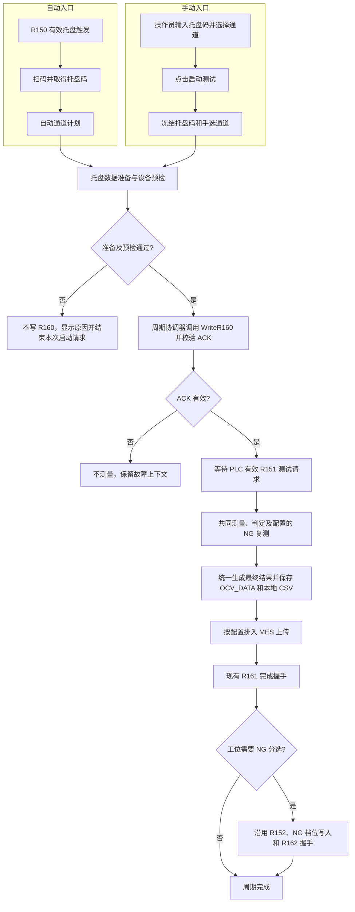

# 主测试页手动模式统一测试周期设计

## 1. 目标

调整主测试页 `frmTest` 的“手动”模式入口，使操作员输入托盘码、选择通道并点击“启动测试”后，系统跳过扫码器和 R150 托盘触发流程，完成现有托盘数据准备，再由 PLC 周期协调器写入 R160。R160 ACK 成功后，仍按现有 PLC 启动契约等待有效的 R151 测试请求。

自动和手动只在周期入口、托盘码来源和测试通道计划上不同。进入共同测试周期后，两者使用同一测量执行器、判定、NG 复测、最终保存、MES 上传及适用的 PLC 完成握手。

本设计只定义行为和实现边界，不包含实现代码或实施步骤。

## 2. 范围与术语

本设计中的“手动模式”仅指主测试页 `frmTest` 左侧“测试控制”区域中的 `chkManualTest`，不是主菜单“测试 → 手动测试”打开的独立 `FrmManualTest`，也不是主测试页的调试开关 `chk_Test`。

| 名称 | 本设计中的含义 |
|---|---|
| 自动入口 | PLC 自动协调器检测 R150 后启动扫码、校验托盘数据并确认托盘码的现有入口 |
| 手动入口 | 操作员输入托盘码、选择通道并点击主测试页“启动测试”的入口 |
| 托盘准备 | 验证托盘码、查询托盘电芯数据、为本周期构造并校验通道与电芯码映射；调试模式沿用其临时代码规则 |
| 测试周期 | 从入口请求被接受开始，到最终结果处理和适用的 PLC 握手结束为止的单托盘任务 |
| 手选通道快照 | 手动点击“启动测试”时冻结的通道集合；本周期不得再从界面重新读取通道选择 |

不改造独立 `FrmManualTest` 的单次/多次测量流程，不把调试模式并入自动/手动模式选择，也不改变 PLC 寄存器定义或 MES 接口。

## 3. 已确认的设计决策

1. **两种入口，共用一个周期协调器。** 自动入口保留 `R150 → 扫码 → 托盘准备 → R160`；手动入口使用已输入托盘码和手选通道，不运行扫码器，也不等待 R150。
2. **按钮是手动周期的唯一启动动作。** 编辑托盘码或改变通道选择本身不启动周期。
3. **先准备，后写 R160。** 登录、报警、周期占用、托盘码、通道映射及设备通信检查全部通过后，协调器才调用现有 `PlcAutomationClient.WriteR160()`。
4. **保留现有 PLC 启动契约。** R160 表示托盘码确认；R151 才是 PLC 发出的测试请求。收到 R160 ACK 后进入等待有效 R151 的状态，再开始测量。R160 ACK 本身不代表 PLC 已请求测量。
5. **入口差异限于来源和通道计划。** 自动周期继续使用其自动通道计划；手动周期使用手选通道快照。共同阶段不因入口而分叉。
6. **协调器管理整个周期。** 主页面手动按钮不再直接进入当前 `StarTest(1)` 的手动后处理分支；避免该分支立即保存并弹出 NG 复测提示，而自动协调器随后又统一复测和发布结果。
7. **PLC 通信按已实现能力限制。** R160 仅使用现有支持它的 PLC ASCII 串口协议。`PLCMode = 1` 的 Modbus TCP 目前没有 R160 映射；未定义并验证映射前，不能把串口 R160 命令当作 TCP 命令发送。

## 4. 用户操作与界面状态

### 4.1 手动启动

操作员在主测试页手动模式下：

1. 输入本次托盘码；
2. 选择一个或多个要测的通道；
3. 点击“启动测试”。

点击时立即捕获托盘码和通道集合，建立单一活动周期。准备或校验失败时显示具体原因，周期不进入 PLC 托盘确认阶段；操作员修正后可再次点击启动。

### 4.2 周期占用期间

从手动启动请求被接受，直到周期成功结束、失败结案或经既有停止/复位路径退出：

- 禁止再次启动，禁止建立第二个并行测试周期；
- 禁止切换自动/手动模式；
- 禁用通道选择，避免影响已冻结的手选通道快照；
- 托盘码及通道显示不得反向修改活动周期上下文；
- PLC 等待期间也保持周期占用，避免 R160 ACK 后重复点击造成重复确认或重复测量。

控件是否允许编辑托盘码由界面实现决定，但即使允许编辑，运行周期也只能使用启动时的托盘码快照。

## 5. 入口和共同周期

入口准备失败时可以结束当前启动请求并释放尚未进入 PLC 流程的占用；R160 已发出或 PLC 已确认后的失败则必须经协调器的故障/停止处理结案，不得简单重新进入空闲并隐去 PLC 状态。

## 6. 手动入口详细规则

### 6.1 接受启动请求并冻结上下文

主页面手动“启动测试”只向周期协调器提交启动请求及入口数据，不直接调用 PLC 客户端或测量器。协调器在接受请求时捕获：

- 托盘码文本的当前值；
- 当前选中的标准通道号集合；
- 当前工位、初始化判定配置和本周期所需的其他稳定测试参数；
- 调试模式开关状态。

启动请求只有在没有其他活动周期时才接受。忙状态下的重复点击应被拒绝或无操作，并保留当前活动周期。

### 6.2 托盘准备与预检

在写 R160 之前，周期协调器必须完成以下准备：

1. 用户已登录，无活动报警，系统没有其他运行中的测试周期；
2. 托盘码符合现有托盘码规则；
3. 至少选择一个通道，通道号在有效范围内且无重复；
4. 常规模式下，根据托盘码查询 OCV_DATA 电芯数据，并确认每个所选通道都有有效电芯码；查询、通道、电芯码校验沿用现有托盘准备服务；
5. `chk_Test` 调试模式开启时，沿用现有调试准备规则，为所选通道生成临时代码；不得因本方案改变调试码规则；
6. 中位机和相关仪表通信检查通过；
7. PLC 协议模式支持当前 R160 命令，且周期协调器所需连接可用。

任意检查失败：

- 不调用 `WriteR160()`；
- 不调用测量入口，不开始 `FormalTestRunner`；
- 给操作员返回可定位的失败原因；
- 允许修正输入或设备状态后重新启动。

如果现有托盘准备服务会更新界面或全局 `RecieveData`，实现必须确保活动周期随后使用的是准备成功后形成的稳定快照，而不是之后可能被下一次 UI 编辑覆盖的数据。

### 6.3 R160 确认与 R151 启动

所有准备成功后，协调器：

1. 将当前周期转入托盘码确认阶段；
2. 通过现有 `PlcAutomationClient.WriteR160()` 发送 R160；
3. 等待并校验现有协议 ACK；
4. ACK 无效、超时或通信失败时，不进入测量；保留托盘码、通道快照及 PLC 错误上下文；
5. ACK 有效后转入等待 PLC 测试请求阶段；
6. 仅在协调器接受到与当前活动周期对应的有效 R151 请求后，调用共同的初始测量阶段。

R151 的有效性和信号沿/电平处理继续采用协调器既有规则。本设计不增加第二套 R151 轮询，也不将 R160 ACK 解释为 R151。手动周期在 R160 ACK 前看到的高电平不作为本周期的启动请求；PLC 必须先将 R151 拉低，再在 ACK 后产生新的有效上升沿。这样可避免将属于旧周期或过早发出的高电平误认成本周期请求。停止/复位若先于已排队的 UI 初测回调执行，该回调必须检查周期代次并被丢弃，不能在复位后启动测量。等待请求期间周期保持占用，可以按既有停止/复位路径退出。

## 7. 共同测试周期

### 7.1 测量入口

协调器通过现有主测试页宿主接口启动初始测量，并调用现有 `FormalTestRunner`。自动入口向协调器提供自动通道计划；手动入口提供启动时冻结的手选通道计划。下游测量代码只消费本周期的通道和电芯码上下文，不能自行重新读取 UI 选项。

通道仍以标准通道号保存于周期上下文，并按现有 `TrayChannelMapping` 转换为设备通道号。只测快照中被选中的通道；不得扩展到全部通道或使用后续更改的选择。

### 7.2 判定与 NG 复测

- OK/NG 仍按初始化设置中的电压、内阻上下限判定；
- 是否复测、复测次数及调度继续沿用现有自动周期配置；
- 复测集合来自本周期实际测量结果中的 NG 通道，不能超出本周期通道集合；
- 手动入口不弹出当前 `StarTest(1)` 手动分支中的即时复测确认框，也不自行调用手动 `StarTest(0)`；
- 测量和配置的复测全部结束后，周期协调器才形成最终结果并进入统一发布阶段。

### 7.3 最终结果发布

自动与手动都在周期协调器统一管理的最终发布阶段：

- 按现有规则保存本周期最终 OCV_DATA 和本地 CSV；
- 按 MES 配置将适用结果排入现有上传流程；调试模式继续遵循不上传生产 MES 的现有规则；
- 不在每一遍测量后重复执行最终保存；初始测量和复测使用周期内结果，最终发布由协调器统一触发；
- 如果测量或最终保存失败，周期按现有失败/复位路径结束，不发送成功的 PLC 完成通知。

MES 上传沿用项目当前的调度和失败处理约定。本设计不新增 MES 接口，也不把 MES 网络成功作为 R161 的新增前置条件。

### 7.4 PLC 完成与 NG 分选握手

最终结果发布成功后沿用现有自动协调器收尾：

1. 发送并处理 R161 测试完成握手；
2. 对要求 NG 分选的工位，沿用 R152 NG 分选请求、NG 档位写入及 R162 握手；
3. 按协调器现有 ACK、超时、错误和复位规则结案。

手动周期不得绕过收尾握手，也不得从窗体事件里另建 R161/R152/R162 通信路径。

## 8. 周期状态与失败行为

| 状态/失败点 | 预期行为 |
|---|---|
| 请求被拒绝：未登录、有报警、已有周期、输入无效 | 不写 R160、不测量；显示原因，等待修正后重试 |
| 托盘查询或电芯码映射失败 | 不写 R160、不测量；显示托盘或通道级错误 |
| 中位机/仪表未就绪 | 不写 R160、不测量；按现有设备故障提示和恢复方式处理 |
| R160 发送失败或 ACK 无效 | 不测量；保持当前托盘/通道和 PLC 错误现场信息 |
| 等待 R151 或初测 UI 回调排队中 | 周期保持占用，重复点击不能重新写入 R160 或启动第二个任务；停止/复位先执行时，过期的排队回调不得启动测量；可用既有停止/复位路径退出 |
| 测量或复测失败 | 使用现有测量取消、设备复位和任务失败处理；不发布成功结果，不发成功 R161 |
| OCV_DATA 或 CSV 最终保存失败 | 不发成功完成握手；保留失败任务信息供现有处理路径使用，不重新测量来掩盖保存失败 |
| R161、R152、NG 档位或 R162 握手失败 | 由当前活动周期保留 PLC 待处理状态，遵循协调器现有恢复策略；不得重测或启动另一周期来绕过 |

周期完成或失败退出时，统一释放忙状态并按现有 UI 刷新流程恢复控件；释放时点由周期协调器决定，而不是由初始测量方法提前决定。

## 9. 实现边界与现有代码适配点

1. **主页面事件层：** `CmdStart_Click` 在手动模式下只做轻量请求校验并提交协调器；移除该入口上的直连 `StarTest(1)` 行为和重复 PLC 通信路径。
2. **周期协调器：** 增加清晰的自动/手动入口数据，统一管理周期占用、R160 ACK、R151 等待、初始测量、NG 复测、最终发布和后续 PLC 握手。
3. **托盘准备：** 复用 `PrepareTrayForTest` / `TrayTestPreparation` 的已有验证能力；协调器拿到准备结果和本周期稳定快照后才能调用 R160。
4. **测量与保存边界：** 调整当前 `StarTest` 主页面路径，使协调器可以请求一次测量并读取该遍结果，但不触发当前手动分支即时保存/弹窗；最终保存和 PLC 完成握手由协调器在所有复测完成后统一触发。`FormalTestRunner` 继续作为物理测量执行层。
5. **自动行为：** 保留自动 `R150 → 扫码 → 托盘准备 → R160 → R151` 入口及其既有通道计划。迁移后自动和手动进入相同的周期后半段，不能因迁移产生两套竞争的自动启动机制。
6. **PLC 协议：** 继续使用 `PlcAutomationClient.WriteR160()` 的串口 ASCII 协议和 ACK 校验。`PLCMode = 1` 的 Modbus TCP R160 支持不在本设计范围内；若需要支持，先单独定义并验证 TCP 地址、数据格式及 ACK 语义。

## 10. 验收标准

1. 只讨论主测试页 `frmTest.chkManualTest`；独立 `FrmManualTest` 的行为不变。
2. 手动模式下输入托盘码、选择通道不会自动开始；只有点击“启动测试”提交周期。
3. 手动入口不启动扫码器，不等待 R150。
4. 未登录、有报警、周期已占用、托盘码/通道/电芯码校验失败或设备未就绪时，不发送 R160。
5. 手动准备成功后只由周期协调器调用现有 `WriteR160()`，且必须通过 ACK 才继续。
6. R160 ACK 后等待当前周期的有效 R151 上升沿；ACK 前的高电平会被丢弃，PLC 需要先复位为低再重新置高；没有有效 R151 时不测量，周期仍占用；不得把 R160 ACK 当作测试请求。
7. 进入测量后仅测试启动时快照中的手选通道，并使用其本周期托盘电芯码。
8. 自动和手动周期共用测量、OK/NG 判定、按配置执行的 NG 复测、最终 OCV_DATA/CSV 保存、MES 排队及适用的 R161/R152/NG 档位/R162 收尾。
9. 手动周期不再从主页面按钮直接进入会立即保存并弹出 NG 复测框的当前分支；每个周期只按最终周期结果执行一次统一发布。
10. R160 失败、R151 缺失、重复点击、停止、测量失败或保存失败均不会造成第二次测量或错误发送成功完成信号。
11. 在未定义 TCP R160 映射时，`PLCMode = 1` 不会伪造或复用串口 R160 命令。

## 11. 不在本设计范围内

- 改变 PLC 对 R160、R151、R161、R152、R162 的现有协议语义；
- 在 R160 ACK 后绕过 R151 立即测量；
- 定义或猜测 Modbus TCP 的 R160 映射；
- 重构独立 `FrmManualTest`、通用报警系统、所有 PLC 通信代码或 MES 服务；
- 改变初始化设置中的判定标准、自动通道计划、NG 复测配置和调试码生成规则；
- 提前确定代码文件拆分、方法签名、提交序列和实施验证命令；这些内容留给设计审阅通过后的实施计划。
